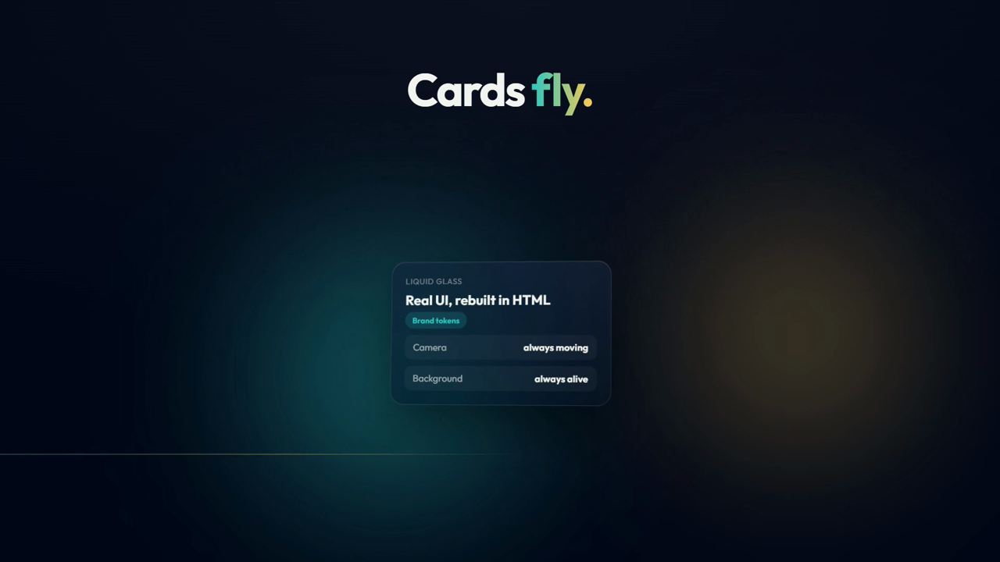
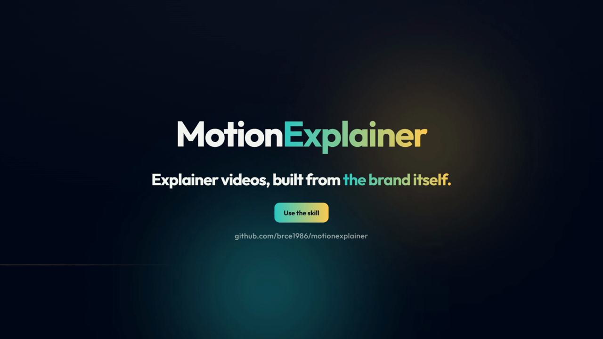

<div align="center">

# 🎬 MotionExplainer

**Give Claude a client's website. Get back a narrated, liquid-glass explainer video built from their own brand.**

[](https://docs.claude.com/en/docs/claude-code/skills)
[](https://github.com/heygen-com/hyperframes)
[](https://gsap.com)
[](https://learn.microsoft.com/azure/ai-services/speech-service/high-definition-voices)
[](LICENSE)


<sub>The demo above is the skill's own base template, rendered unchanged.</sub>

</div>

---

## ✨ What it does

MotionExplainer is a [Claude Code](https://claude.com/claude-code) skill that runs a full motion-design pipeline for you:

| | |
|---|---|
| 🎨 **Brand from the source** | Reads the client's site and pulls the real colours, gradients, webfonts, photos and logo. No guessing, no stock look. |
| 🌀 **The client's logo, animated** | Splits their SVG into parts. The mark spins in, the letters rise in groups, and the mark can come back as a seal or a transition iris. |
| 🧊 **Liquid glass, never a slideshow** | One 3D world with a camera that keeps moving, cards that fly out of buttons and morph into each other, focus blur, and a background that never stops. |
| 🎙️ **A voice that is checked** | Azure Speech HD neural voices (Gemini TTS as fallback). Every take, and the final mix, is transcribed and compared with the script, so no word gets lost. |
| 🎵 **Sound locked to the words** | Music and SFX synthesised in code (zero licensing). The brand line lands on a downbeat, and every SFX sits on the word it illustrates. |
| 🔍 **A glitch hunt before delivery** | 10 fps contact sheets of the **rendered MP4** around every transition, checked against a list of real-world glitches. |
| 🎞️ **Tuned to your taste** | Send ≥3 reference videos (YouTube is fine). The skill reads their pace, camera and transitions, and borrows from them. |

<table>
<tr>
<td></td>
<td></td>
</tr>
<tr>
<td align="center"><sub>Title band + a glass card arriving from depth</sub></td>
<td align="center"><sub>Lockup: the logo lifts to make room for the CTA and URL</sub></td>
</tr>
</table>

## 🚀 Quick start

```bash
# 1. install the skill
git clone https://github.com/brce1986/motionexplainer ~/.claude/skills/motionexplainer

# 2. check your machine (it prints install commands for anything missing)
python ~/.claude/skills/motionexplainer/scripts/doctor.py

# 3. keys go in your environment or a local .env, never in the repo
cp ~/.claude/skills/motionexplainer/.env.example ./.env   # then fill it in
```

Then, in Claude Code:

> *"Make a 60s explainer for https://client.com. References: <yt link 1>, <yt link 2>, <yt link 3>. Logo attached."*

On its first reply, the skill **checks your setup** and **tells you exactly what it needs** before it does anything:

- ✅ the client's **website** or an **assets folder**
- ✅ the **product logo**: SVG preferred, so it can be animated part by part
- ✅ **at least 3 reference videos**
- ✅ **Azure Speech** key + region (primary voice + transcription check) and a **Gemini** key (fallback)
- ✅ format (16:9 / 9:16), duration, VO language, CTA

## 🧭 The pipeline

```
 G1 References ──► G2 Brand & story ──► G3 Script + beat sheet ──► ✋ your approval
                                                                        │
 G8 Render 60fps ◄── G7 Glitch hunt ◄── G6 Build ◄── G5 Soundtrack ◄── G4 Voice (2 takes, checked)
```

Each gate shows its result before moving on. You can ask for several cuts (e.g. *with phone / no phone / free style*) that share the same script and audio.

## 🧰 Requirements

`doctor.py` checks all of these on the first call:

| Dependency | Used for | Install |
|---|---|---|
| **Python 3.10+** + `numpy`, `scipy` | scripts, soundtrack synthesis | `pip install numpy scipy` |
| **FFmpeg / FFprobe** (full build) | mixing, loudness, contact sheets, frames | `winget install Gyan.FFmpeg` · `brew install ffmpeg` · `apt install ffmpeg` |
| **Node.js 20+** / npx | runs HyperFrames | `winget install OpenJS.NodeJS.LTS` · `brew install node` |
| **HyperFrames 0.8.198** | HTML → MP4 (bundles headless Chromium) | automatic via `npx` |
| **GSAP 3.14.2** | animation runtime (CDN) | network access |
| **Azure Speech** | HD voices + transcription check | Azure portal → *Speech* resource |
| **Gemini API** | fallback voice | Google AI Studio |
| yt-dlp *(optional)* | reference video frames | `pip install yt-dlp` |

## 📁 What's inside

```
motionexplainer/
├── SKILL.md                    # the workflow + the first-reply checklist
├── references/
│   ├── style.md                # the house style: camera, glass, flights, morphs, brand, lockup
│   ├── brand-extraction.md     # tokens, fonts, photos, the story
│   ├── reference-videos.md     # how references are read and what to borrow
│   ├── script.md               # script + beat sheet rules
│   ├── audio.md                # voices, checks, breath, soundtrack
│   ├── build.md                # project layout, rendering, delivery
│   └── qa.md                   # the glitch checklist (symptom → cause → fix)
├── scripts/
│   ├── doctor.py               # dependency + key check (keys never printed)
│   ├── tts_azure.py            # Azure HD voices from a plain script
│   ├── tts_gemini.py           # Gemini TTS fallback
│   ├── stt_check.py            # transcribe + compare with the script, word timings
│   ├── insert_breath.py        # one-bar breath before the logo
│   ├── soundtrack.py           # music + SFX + ducking + -14 LUFS, from a cues JSON
│   ├── logo_split.py           # inline SVG logo, split into animatable groups
│   ├── extract_brand.js        # run in the client's page → brand tokens JSON
│   ├── ref_frames.py           # contact sheets of a reference video
│   └── sheets.py               # 10 fps contact sheets for the glitch hunt
├── templates/
│   ├── composition.html        # base composition with every style helper
│   └── cues.example.json
└── assets/vendor/devices.css   # phone mockups (MIT)
```

## 🔐 Keys & privacy

- Keys are read **only** from environment variables or a local `.env`, which `.gitignore` excludes. Scripts never print them.
- If a key ends up in a chat, a log or a commit, **rotate it** in the provider's portal.
- Media (`*.mp4`, `*.mp3`, `*.wav`), references and QA output are git-ignored by default.

## ⚖️ Responsible use

- Use a client's logo, fonts and photos **only for that client's video**, with their permission. Check the licences of commercial webfonts and stock photos.
- Reference videos are downloaded **for frame analysis only** and deleted afterwards. Don't redistribute them.
- Every claim in a script must come from the client's own material.

## 🙌 Credits

Built on [HyperFrames](https://github.com/heygen-com/hyperframes) by HeyGen, [GSAP](https://gsap.com), [devices.css](https://github.com/picturepan2/devices.css) (MIT), Azure Speech and Gemini. The demo uses [Outfit](https://fonts.google.com/specimen/Outfit) (OFL).

## 📄 License

[MIT](LICENSE) © 2026 Bruno Reis
